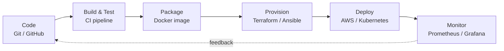

<!--
  DESIGN 3 — "Terminal / Pipeline"
  Palette: #0D1117 (bg) · #00FF9C (terminal green) · #58A6FF (blue) · #FF9900 (AWS accent)
  Replace: YOUR_LINKEDIN, your.email@example.com, https://your-portfolio.com, project placeholders
-->

<div align="center">


</div>

<br/>

## `~/about`

```yaml
name: Sambit Kumar Choudhuri
role: Aspiring AWS DevOps Engineer
location: Kolkata, India
experience: 3 years (AWS / DevOps-related)
focus:
  - CI/CD pipelines
  - Infrastructure as Code
  - Containers & orchestration
  - Monitoring & observability
  - Linux & automation
learning: [Kubernetes, Terraform, AWS architecture, GitOps]
goal: Join a team as an AWS DevOps / Cloud Engineer
status: open_to_opportunities
```

I like turning manual work into **version-controlled, repeatable automation**, and I treat every project as a chance to learn something new.

<br/>

## `~/skills`

<div align="center">

| Category | Stack |
| :-- | :-- |
| **Cloud** |    |
| **Containers** |   |
| **CI/CD** |    |
| **IaC** |   |
| **Monitoring** |   |
| **Systems & Scripting** |     |
| **Version Control** |   |
| **Fundamentals** | Networking · Security basics (IAM, least privilege, secrets) |

</div>

<br/>

## `~/workflow`

How I think about delivering software:



<br/>

## `~/projects`

> _Replace with your real projects._

| # | Project | Description | Stack | Repo |
| :-: | :-- | :-- | :-- | :-: |
| 01 | **Project Name 1** | _What it does and the problem it solves_ | `AWS` `Terraform` | [🔗](https://github.com/sambit-8490/project-1) |
| 02 | **Project Name 2** | _What it does and the problem it solves_ | `Docker` `Kubernetes` | [🔗](https://github.com/sambit-8490/project-2) |
| 03 | **Project Name 3** | _What it does and the problem it solves_ | `Jenkins` `GitHub Actions` | [🔗](https://github.com/sambit-8490/project-3) |
| 04 | **Project Name 4** | _What it does and the problem it solves_ | `Ansible` `Bash` | [🔗](https://github.com/sambit-8490/project-4) |

**Key achievements (add real ones):**
- _Achievement 1, e.g. reduced deployment time by X%_
- _Achievement 2_

<br/>

## `~/stats`

<div align="center">


</div>

<br/>

## `~/learning`

```bash
$ cat learning.txt
[ ] Kubernetes   → deployments, services, ingress, Helm
[ ] Terraform    → modules, remote state, reusable patterns
[ ] AWS          → architecture, high availability, IAM best practices
[ ] Automation   → GitOps, pipeline design, observability
```

<br/>

## `~/contact`

<div align="center">

[](https://linkedin.com/in/YOUR_LINKEDIN)
[](https://github.com/sambit-8490)
[](mailto:your.email@example.com)
[](https://your-portfolio.com)

<br/>


<br/><br/>

```text
"Automate the boring stuff, so you can focus on what matters."
```

**Thanks for visiting. Let's ship reliable systems together. 🚀**


</div>
